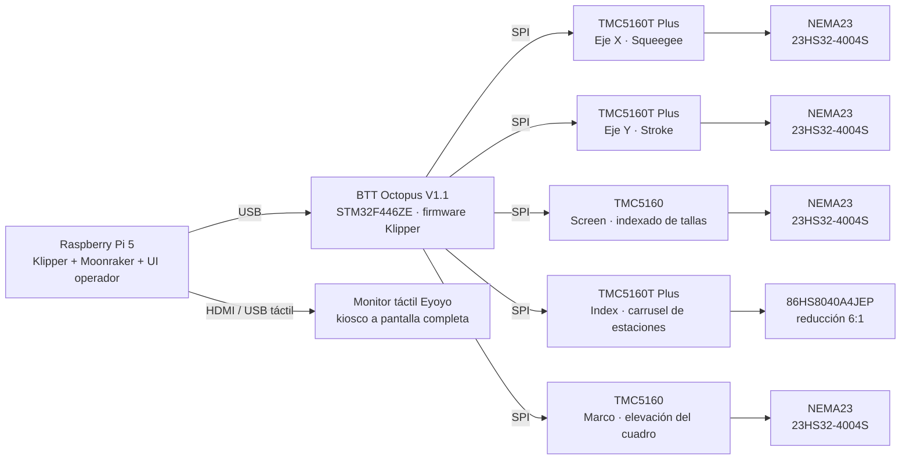

# LP1 — Máquina de serigrafía automática

**Español** · [English](README.md)

Sistema de control de una máquina de serigrafía automática comercial con cabeza de impresión CoreXY, carrusel de 4 estaciones y cinco ejes de motores paso a paso. Toda la máquina la gobierna una **Raspberry Pi 5 con Klipper**, conectada por USB a una placa **BTT Octopus V1.1** (STM32), con una interfaz táctil propia para el operador.

El proyecto sustituyó una arquitectura anterior basada en firmware Marlin, un secuenciador Teensy/ESP32 y una HMI Wecon por una única plataforma de control definida por software.

## Demostración

https://github.com/user-attachments/assets/c0476378-dec0-4a6f-bca2-bbb95acb78f8

## Aspectos destacados

- **Control de movimiento de 5 ejes** con Klipper: cabeza CoreXY (stroke + squeegee), indexador del carrusel, indexador de tallas y elevación del marco.
- **Home sensorless** (StallGuard de los TMC5160) en cuatro ejes, calibrado por eje y por velocidad de home.
- **Ciclo de impresión completo escrito como macros de Klipper** (G-code + Jinja2): embarre, movimiento sincronizado de marco y squeegee, pasada de impresión, avance del carrusel y detección de prenda.
- **Interfaz de operador propia**: aplicación HTML/JavaScript de una sola página que se comunica con Moonraker por WebSocket (JSON-RPC), bilingüe español/inglés, en modo kiosco a pantalla completa.
- **Lógica de seguridad en software**: modo manual con guardas, home obligatorio antes de cualquier ciclo y botón de paro de emergencia con apagado inmediato del firmware.
- **Validación automática de macros**: un banco de pruebas en Python que renderiza cada macro con Jinja2 igual que Klipper, antes de desplegar en la máquina.

## Arquitectura de control

## Hardware

### Control e interfaz

| Componente | Modelo | Función |
|---|---|---|
| Computadora de control | Raspberry Pi 5 | Corre Klipper, la API Moonraker y la interfaz web del operador |
| Placa controladora | BTT Octopus V1.1, STM32F446ZE | Ejecuta el firmware MCU de Klipper y controla todos los drivers por SPI |
| Pantalla | Monitor táctil Eyoyo, HDMI + USB | Interfaz del operador en modo kiosco a pantalla completa |
| Fuente de alimentación | 24 V DC, 12 A | Alimentación de potencia de los drivers |

### Ejes, drivers y motores

| Eje | Función | Driver | Motor | Corriente | Home |
|---|---|---|---|---|---|
| **X** | Squeegee, sube y baja | TMC5160T Plus, SPI | NEMA23 StepperOnline 23HS32-4004S, 2.4 Nm | 2.0 A | Sensorless, StallGuard |
| **Y** | Stroke, recorrido largo del carro | TMC5160T Plus, SPI | NEMA23 StepperOnline 23HS32-4004S, 2.4 Nm | 2.0 A | Sensorless, StallGuard |
| **Screen** | Indexado de tallas | TMC5160, SPI | NEMA23 StepperOnline 23HS32-4004S, 2.4 Nm | 2.0 A | Sensorless, StallGuard |
| **Index** | Carrusel de 4 estaciones | TMC5160T Plus, SPI, HVIN de 24 V dedicado | 86HS8040A4JEP con reducción mecánica 6:1 | 2.8 A | Sensor inductivo NPN |
| **Marco** | Sube y baja el cuadro | TMC5160, SPI | NEMA23 StepperOnline 23HS32-4004S, 2.4 Nm | 1.2 A | Sensorless, StallGuard |

Todos los drivers trabajan en modo SpreadCycle, para máximo par y una detección de stall fiable.

### Sensores y entradas

- **Sensor de parte:** fotoeléctrico difuso NPN que detecta la prenda en el carrusel, para saltar automáticamente las estaciones vacías.
- **Home del carrusel:** sensor inductivo NPN.
- **Paro de emergencia:** botón industrial tipo hongo conectado a la Octopus; al pulsarlo el firmware se apaga de inmediato y los motores se detienen en decenas de milisegundos.

## Mapeo de ejes (CoreXY)

| Eje | Función | Sentido |
|---|---|---|
| **Y** | Stroke | `Y+` hacia un extremo, `Y-` hacia el otro |
| **X** | Squeegee | `X+` = subir, posición segura · `X-` = bajar, hacia la malla |

La cabeza es mecánicamente CoreXY: los dos motores girando en el mismo sentido producen el stroke, y en sentidos opuestos producen el movimiento del squeegee.

## Ciclo de impresión

El operador hace home con `HOME_ALL` y arranca la producción con `START`. Cada ciclo es:

1. **Embarre:** el carro viaja al otro extremo con el squeegee y el marco arriba, repartiendo la tinta sobre la malla con el floodbar. En modo carrusel esto ocurre mientras gira el carrusel, para ahorrar tiempo de ciclo.
2. **Bajada:** el marco y el squeegee bajan a la vez.
3. **Pasada de impresión:** el carro regresa con el squeegee abajo e imprime la prenda.
4. **Subida:** el squeegee y el marco suben a la vez; el squeegee se separa primero de la malla.
5. **Avance del carrusel:** el carrusel pasa a la siguiente estación. El sensor de parte decide si esa estación se imprime o se salta.

Hay dos modos de operación: **modo cabeza**, una sola estación de impresión, y **modo carrusel**, un ciclo continuo de 4 estaciones. Todos los parámetros del ciclo — posiciones, velocidades, lado de inicio y uso del marco — se ajustan desde la pantalla táctil y quedan guardados en la máquina.

## Interfaz del operador

Aplicación web táctil en `ui/index.html`, que arranca con la máquina en modo kiosco: cage + Chromium como servicio de systemd, con pantalla de arranque Plymouth personalizada.

- **Pantalla principal:** home, arranque/parada y estado del ciclo en tiempo real.
- **Modo manual:** cada paso del ciclo automático como un botón independiente, para clientes que producen paso a paso. Usa exactamente las mismas posiciones, velocidades y aceleraciones que el ciclo automático, e impide acciones inseguras: no hay movimiento sin home ni con un ciclo en marcha, y el squeegee no baja si el marco no está en su posición.
- **Ajustes:** velocidad en escala 0–99, donde 99 equivale a 21 000 mm/min, y posiciones de la cabeza y del carrusel.
- **Menú:** acceso a ajustes, modo manual y selección de idioma.
- **Pantalla de paro de emergencia:** aparece en cuanto se pulsa el botón físico, con un botón de reinicio del firmware.

## Notas de ingeniería

Algunos de los problemas resueltos durante el desarrollo:

- **La calibración de StallGuard depende de la velocidad.** El umbral de stall que hace un home fiable a una velocidad falla a otra, así que cada eje sensorless se calibró por bisección a su velocidad y aceleración reales de home, y las macros de home fijan esos valores explícitamente.
- **Sensores asíncronos dentro de Klipper.** Las mediciones mostraron que los eventos de `gcode_button` se encolan hasta que termina la macro en curso. El bucle del carrusel se rediseñó en dos pasos — uno para mover y otro para leer la detección — de modo que nunca se pierde una prenda.
- **Límites del perfil de movimiento.** En movimientos cortos el perfil de velocidad es triangular y nunca se alcanza la velocidad pedida; la velocidad pico queda limitada por √(aceleración × distancia). La aceleración se subió de forma gradual, verificando con la repetibilidad del home que no se perdieran pasos.
- **Orden de carga de la configuración.** Los pines de endstop virtual de los drivers TMC deben registrarse antes que el motor que los usa, lo que define el orden de las secciones en `printer.cfg`.
- **Estado seguro al liberar motores.** `M84`/`M18` están interceptados: cualquier liberación de motores aborta el ciclo en curso e invalida todos los homes, obligando a hacer home antes de volver a producir.
- **Una única fuente de verdad.** El modo manual y el automático leen los mismos parámetros guardados, así que un cambio en ajustes se aplica a los dos y nunca imprimen distinto.

## Estructura del repositorio

| Ruta | Contenido |
|---|---|
| `pi-config/printer.cfg` | Configuración principal de Klipper: ejes, drivers TMC5160, sensor de parte, paro de emergencia, override de `G28`. |
| `pi-config/macros_ciclo.cfg` | Ciclo de impresión, bucle del carrusel, modos de operación y parámetros del operador (`SET_CYCLE`). |
| `pi-config/macros_marco.cfg` | Motor del marco: home sensorless, bajada y subida. |
| `pi-config/macros_manual.cfg` | Macros del modo manual. |
| `pi-config/macros_index.cfg` | Carrusel de 4 estaciones: home, indexado y sensor de parte. |
| `pi-config/macros_screen.cfg` | Indexado de tallas del screen. |
| `pi-config/variables.cfg` | Ajustes guardados del operador: posiciones calibradas, velocidades y modo. |
| `pi-config/moonraker.conf`, `fluidd.cfg`, `system/` | Moonraker, Fluidd y servicios del kiosco: nginx, cage y Chromium. |
| `pi-config/tests/validar_macros.py` | Validador que renderiza cada macro con Jinja2 igual que Klipper. |
| `ui/` | Interfaz táctil del operador. |
| `boot/` | Pantalla de arranque personalizada y configuración de arranque de la Raspberry Pi. |
| `_legacy/` | Firmware del secuenciador Teensy/ESP32 anterior, como referencia. |

La configuración en uso corre en la Raspberry Pi, en `~/printer_data/config/`; `pi-config/` es su copia bajo control de versiones y se despliega a la máquina tras cada cambio.

## Próximos pasos

- Corte de potencia por hardware en el paro de emergencia: cablear el contacto NC del botón en serie con la alimentación de 24 V de los drivers, para que la parada no dependa del controlador.
- Calibrar el recorrido del squeegee y del marco en milímetros reales.

## Tecnologías

Klipper · Moonraker · Raspberry Pi OS · STM32 · TMC5160 · macros G-code / Jinja2 · HTML / CSS / JavaScript · WebSocket JSON-RPC · Python · systemd · nginx · Git
