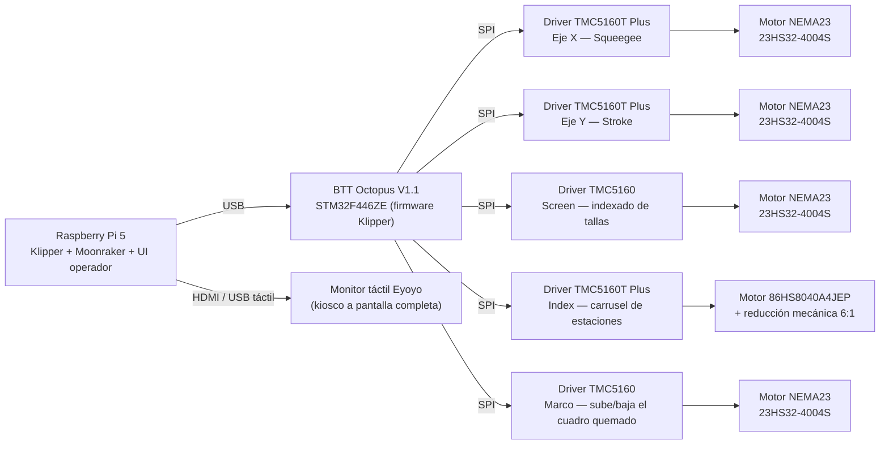
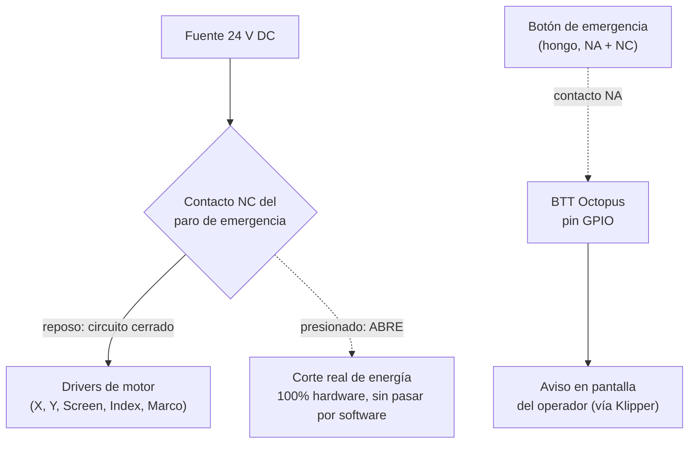

# LP1 — Máquina de serigrafía automática (CoreXY)

**Español** · [English](README.md)

Máquina de serigrafía comercial con cabeza CoreXY, controlada 100 % por una Raspberry Pi corriendo **Klipper**, que gobierna una placa **BTT Octopus V1.1** por USB. Este repositorio contiene el código y la configuración que corre en la máquina (sin material de documentación de desarrollo interno).

## Arquitectura de control

## Lista de materiales eléctricos / electrónicos

### Control e interfaz

| Componente | Modelo | Función |
|---|---|---|
| Computadora de control | Raspberry Pi 5 | Corre Klipper (host), Moonraker (API) y la interfaz web del operador |
| Placa controladora | BTT Octopus V1.1 (MCU STM32F446ZE) | Ejecuta el firmware de Klipper; controla los drivers de motor por SPI |
| Pantalla | Monitor táctil Eyoyo (HDMI + USB) | Interfaz del operador, en modo kiosco a pantalla completa |

### Drivers y motores por eje

| Eje / función | Driver | Motor | Corriente de trabajo | Home |
|---|---|---|---|---|
| **X** — Squeegee (sube/baja) | TMC5160T Plus (SPI) | NEMA23 StepperOnline 23HS32-4004S (4.0 A pico/fase, 2.4 Nm) | 2.0 A | Sensorless (StallGuard, sin sensor físico) |
| **Y** — Stroke (recorrido) | TMC5160T Plus (SPI) | NEMA23 StepperOnline 23HS32-4004S (4.0 A pico/fase, 2.4 Nm) | 2.0 A | Sensorless (StallGuard, sin sensor físico) |
| **Screen** — indexado de tallas | TMC5160 estándar (SPI) | NEMA23 StepperOnline 23HS32-4004S (4.0 A pico/fase, 2.4 Nm) | 2.0 A *(provisional)* | Switch/jumper en el zócalo del driver |
| **Index** — carrusel de 4 estaciones | TMC5160T Plus (SPI), alimentación de potencia (HVIN) independiente a 24 V | 86HS8040A4JEP (4.0 A RMS de placa) + reducción mecánica 6:1 | 2.8 A | Sensor inductivo NPN |
| **Marco** — sube/baja el cuadro quemado | TMC5160 (SPI) | NEMA23 StepperOnline 23HS32-4004S (4.0 A pico/fase, 2.4 Nm) | 1.2 A | Sensorless (StallGuard) contra el tope de arriba |

### Sensores

- **Sensor de parte** (detecta la prenda en el carrusel): fotoeléctrico difuso NPN.
- **Home del carrusel (index):** sensor inductivo NPN.
- **Home de X/Y y del marco:** sin sensor físico — se usa detección de stall (StallGuard) integrada en los propios drivers. La sensibilidad (`driver_SGT`) depende de la velocidad de home: si esta cambia, hay que recalibrarla.

### Alimentación

- Riel de **24 V DC** para los drivers de motor (nunca 48 V: los módulos comparten dominio de tensión con la placa por el zócalo).
- Fuente/PSU: **24 V, 12 A**. Modelo exacto pendiente de documentar aquí.

### Seguridad — paro de emergencia *(en desarrollo)*

Botón industrial tipo "hongo" de doble contacto (NC + NA):

- **NC (diseño):** corta por hardware la alimentación de 24 V de los drivers — parada real e inmediata, independiente de Klipper/software.
- **NA:** cableado desde 2026-09-23 a un pin de la Octopus. Al pulsarlo, Klipper entra en *shutdown* de inmediato (el MCU frena los motores en decenas de ms) y la pantalla muestra el aviso de paro; se sale con el botón RESET, que hace `FIRMWARE_RESTART`.
- **NC:** **todavía sin cablear.** Mientras falte, el corte real de energía no existe: el botón detiene a Klipper pero no desconecta la potencia de los drivers. No confiar en él como paro de emergencia completo.

## Mapeo de ejes (CoreXY)

| Eje | Función | Sentido |
|---|---|---|
| **Y** | Stroke — recorrido largo del carro | `Y+` a un extremo, `Y-` al otro |
| **X** | Squeegee — sube/baja | `X+` = subir (posición segura) · `X-` = bajar (hacia la malla) |

> La cabeza es físicamente CoreXY (dos motores): el mismo sentido entre ambos produce stroke, sentidos opuestos producen squeegee. Esta relación puede invertirse si se retensa o remonta una banda — se revalida en máquina antes de operar.

## Ciclo de impresión

El operador hace `HOME_ALL` (obligatorio: `START` no funciona sin home) y luego `START`. Cada ciclo de cabeza es:

1. **Embarre:** el stroke viaja al otro extremo con el squeegee **y el marco arriba**, en vacío, para repartir la pintura (floatbar). En modo carrusel esto ocurre a la vez que gira el plato.
2. **Bajada:** con `MARCO=SI`, el marco y el squeegee bajan **a la vez**.
3. **Impresión:** el stroke regresa con el squeegee abajo. Esta es la pasada que imprime.
4. **Subida:** el squeegee y el marco suben a la vez (el squeegee sale primero un tramo corto).

Después, el carrusel avanza una estación (`INDEX_NEXT`). Con `MARCO=NO` el marco no participa.

**Modos:** *cabeza* (el ciclo empieza y termina en el lado de inicio) y *carrusel* (4 estaciones; el sensor de parte decide si se imprime o se salta la estación).

## Interfaz del operador

Interfaz web en `ui/index.html`, servida en modo kiosco en la pantalla táctil:

- **Pantalla principal:** home, start/stop y estado del ciclo.
- **MANUAL:** los mismos movimientos del ciclo, de uno en uno (marco abajo → stroke de ida → bajar squeegee → stroke de regreso imprimiendo → subir squeegee → marco arriba → avanzar carrusel). Usa las mismas posiciones, velocidades y aceleración que el ciclo automático, y tiene guardas: no deja moverse sin home, ni con el ciclo en marcha, ni bajar el squeegee con el marco fuera de su sitio.
- **AJUSTES:** velocidad (escala 0–99, donde 99 equivale a 21 000 mm/min) y posiciones de cabeza e index.
- **MENÚ:** acceso a AJUSTES y MANUAL, y selector de idioma.
- **Paro de emergencia:** pantalla de aviso cuando se pulsa el botón físico.

## Estructura del repositorio

| Ruta | Contenido |
|---|---|
| `pi-config/printer.cfg` | Config principal de Klipper: ejes, drivers TMC5160, sensor de parte, botón de paro, override de `G28`. |
| `pi-config/macros_ciclo.cfg` | Ciclo de impresión, bucle del carrusel, modos, parámetros del operador (`SET_CYCLE`). |
| `pi-config/macros_marco.cfg` | Motor del marco: home sensorless, bajar/subir. |
| `pi-config/macros_manual.cfg` | Macros de la pantalla MANUAL. |
| `pi-config/macros_index.cfg` | Carrusel de 4 estaciones: home, indexado, sensor de parte. |
| `pi-config/macros_screen.cfg` | Indexado de tallas del screen. |
| `pi-config/variables.cfg` | Estado guardado del operador (posiciones calibradas, velocidades, modo). Klipper lo reescribe en caliente. |
| `pi-config/moonraker.conf`, `fluidd.cfg`, `system/` | Moonraker, Fluidd y servicios del kiosco (nginx, Chromium). |
| `pi-config/tests/validar_macros.py` | Validador que renderiza cada macro de forma aislada. |
| `ui/` | Interfaz del operador. |
| `boot/` | Pantalla de arranque (splash) y archivos originales de arranque de la Pi. |
| `_legacy/` | Código antiguo (secuenciador Teensy/ESP32), solo como referencia histórica. |

> **Importante:** la configuración que ejecuta la máquina vive en la Raspberry Pi (`~/printer_data/config/`). `pi-config/` es una copia versionada: editarla aquí no cambia nada en la máquina hasta desplegarla.
