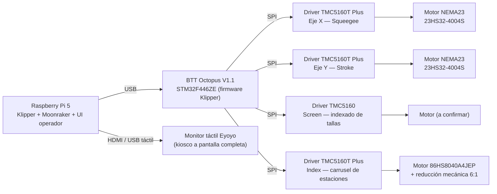
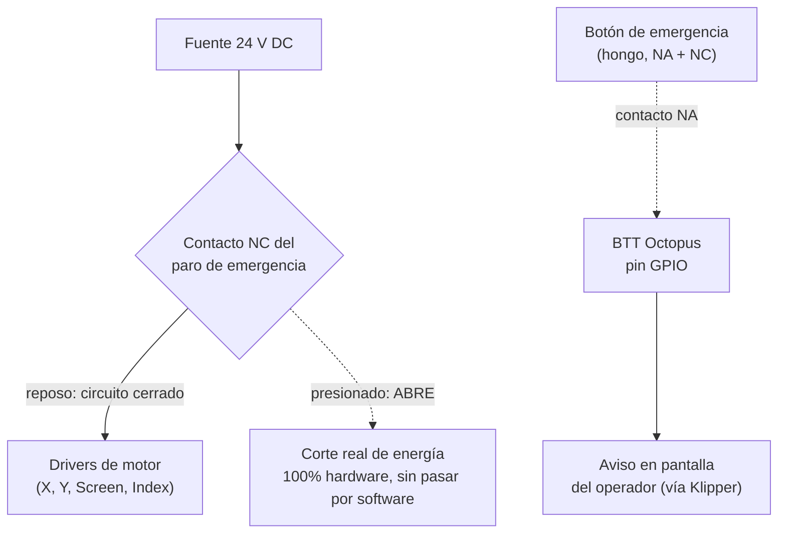

# LP1 — Máquina de serigrafía automática (CoreXY)

Máquina de serigrafía comercial con cabeza CoreXY, controlada 100 % por una Raspberry Pi corriendo **Klipper**, que gobierna una placa **BTT Octopus V1.1** por USB. Este repositorio contiene el código y la configuración que corre en la máquina (sin material de documentación de desarrollo interno).

## Arquitectura de control

## Lista de materiales eléctricos / electrónicos

### Control e interfaz

| Componente | Modelo | Función |
|---|---|---|
| Computadora de control | Raspberry Pi 5 | Corre Klipper (host), Moonraker (API) y la interfaz web del operador |
| Placa controladora | BTT Octopus V1.1 (MCU STM32F446ZE) | Ejecuta el firmware de Klipper; controla los drivers de motor por SPI |
| Pantalla | Monitor táctil Eyoyo (HDMI + USB) | Interfaz del operador, en modo kiosco a pantalla completa |

### Drivers y motores por eje

| Eje / función | Driver | Motor | Corriente de trabajo | Home |
|---|---|---|---|---|
| **X** — Squeegee (sube/baja) | TMC5160T Plus (SPI) | NEMA23 StepperOnline 23HS32-4004S (4.0 A pico/fase, 2.4 Nm) | 2.0 A | Sensorless (StallGuard, sin sensor físico) |
| **Y** — Stroke (recorrido) | TMC5160T Plus (SPI) | NEMA23 StepperOnline 23HS32-4004S (4.0 A pico/fase, 2.4 Nm) | 2.0 A | Sensorless (StallGuard, sin sensor físico) |
| **Screen** — indexado de tallas | TMC5160 estándar (SPI) | Pendiente de confirmar (corriente provisional) | 2.0 A *(provisional)* | Switch/jumper en el zócalo del driver |
| **Index** — carrusel de 4 estaciones | TMC5160T Plus (SPI), alimentación de potencia (HVIN) independiente a 24 V | 86HS8040A4JEP (4.0 A RMS de placa) + reducción mecánica 6:1 | 2.8 A | Sensor inductivo NPN |

### Sensores

- **Sensor de parte** (detecta la prenda en el carrusel): fotoeléctrico difuso NPN.
- **Home del carrusel (index):** sensor inductivo NPN.
- **Home de X/Y:** sin sensor físico — se usa detección de stall (StallGuard) integrada en los propios drivers.

### Alimentación

- Riel de **24 V DC** para los drivers de motor (nunca 48 V: los módulos comparten dominio de tensión con la placa por el zócalo).
- Fuente/PSU: modelo y capacidad exactos pendientes de documentar aquí.

### Seguridad — paro de emergencia *(en desarrollo)*

Botón industrial tipo "hongo" de doble contacto (NC + NA):

- **NC:** corta por hardware la alimentación de 24 V de los drivers — parada real e inmediata, independiente de Klipper/software.
- **NA:** solo avisa a Klipper y a la pantalla; no participa en el corte real. Todavía sin cablear en la máquina física.

## Mapeo de ejes (CoreXY)

| Eje | Función | Sentido |
|---|---|---|
| **Y** | Stroke — recorrido largo del carro | `Y+` a un extremo, `Y-` al otro |
| **X** | Squeegee — sube/baja | `X+` = subir (posición segura) · `X-` = bajar (hacia la malla) |

> La cabeza es físicamente CoreXY (dos motores): el mismo sentido entre ambos produce stroke, sentidos opuestos producen squeegee. Esta relación puede invertirse si se retensa o remonta una banda — se revalida en máquina antes de operar.
