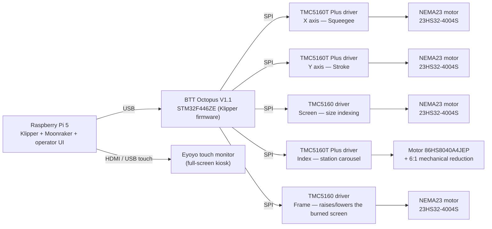
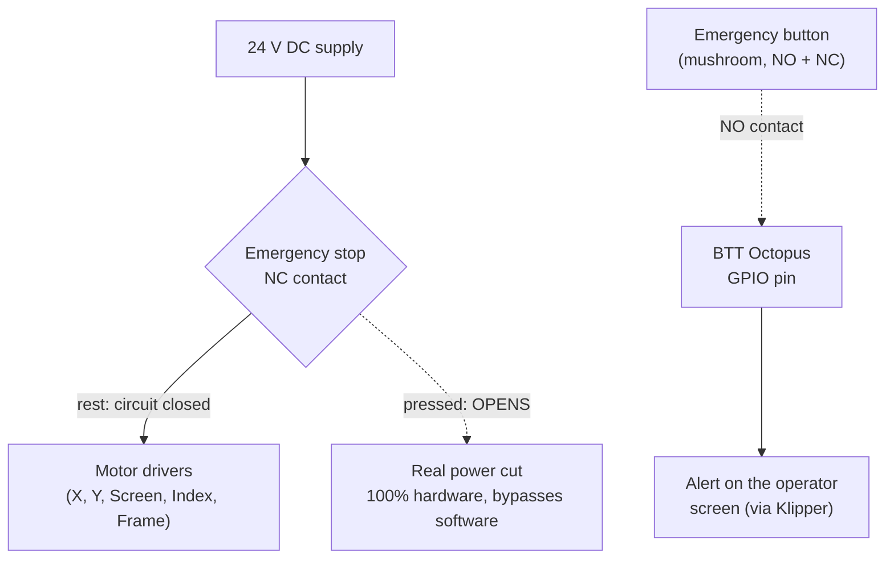

# LP1 — Automatic Screen Printing Machine (CoreXY)

[Español](README.es.md) · **English**

A commercial screen printing machine with a CoreXY head, controlled 100 % by a Raspberry Pi running **Klipper**, which drives a **BTT Octopus V1.1** board over USB. This repository contains the code and configuration that run on the machine (without internal development documentation).

## Control architecture

## Electrical / electronic bill of materials

### Control and interface

| Component | Model | Function |
|---|---|---|
| Control computer | Raspberry Pi 5 | Runs Klipper (host), Moonraker (API) and the operator web interface |
| Controller board | BTT Octopus V1.1 (STM32F446ZE MCU) | Runs the Klipper firmware; controls the motor drivers over SPI |
| Display | Eyoyo touch monitor (HDMI + USB) | Operator interface, full-screen kiosk mode |

### Drivers and motors per axis

| Axis / function | Driver | Motor | Working current | Home |
|---|---|---|---|---|
| **X** — Squeegee (up/down) | TMC5160T Plus (SPI) | NEMA23 StepperOnline 23HS32-4004S (4.0 A peak/phase, 2.4 Nm) | 2.0 A | Sensorless (StallGuard, no physical sensor) |
| **Y** — Stroke (travel) | TMC5160T Plus (SPI) | NEMA23 StepperOnline 23HS32-4004S (4.0 A peak/phase, 2.4 Nm) | 2.0 A | Sensorless (StallGuard, no physical sensor) |
| **Screen** — size indexing | Standard TMC5160 (SPI) | NEMA23 StepperOnline 23HS32-4004S (4.0 A peak/phase, 2.4 Nm) | 2.0 A *(provisional)* | Switch/jumper on the driver socket |
| **Index** — 4-station carousel | TMC5160T Plus (SPI), independent 24 V power supply (HVIN) | 86HS8040A4JEP (4.0 A RMS nameplate) + 6:1 mechanical reduction | 2.8 A | NPN inductive sensor |
| **Frame** — raises/lowers the burned screen | TMC5160 (SPI) | NEMA23 StepperOnline 23HS32-4004S (4.0 A peak/phase, 2.4 Nm) | 1.2 A | Sensorless (StallGuard) against the upper stop |

### Sensors

- **Part sensor** (detects the garment on the carousel): NPN diffuse photoelectric.
- **Carousel (index) home:** NPN inductive sensor.
- **X/Y and frame home:** no physical sensor — stall detection (StallGuard) built into the drivers is used. The sensitivity (`driver_SGT`) depends on the homing speed: if the speed changes, it must be recalibrated.

### Power

- **24 V DC** rail for the motor drivers (never 48 V: the modules share a voltage domain with the board through the socket).
- PSU: **24 V, 12 A**. Exact model still to be documented here.

### Safety — emergency stop *(in development)*

Industrial mushroom button with two contacts (NC + NO):

- **NC (design):** cuts the drivers' 24 V supply in hardware — a real, immediate stop, independent of Klipper/software.
- **NO:** wired since 2026-09-23 to an Octopus pin. When pressed, Klipper goes into *shutdown* immediately (the MCU stops the motors within tens of ms) and the screen shows the stop alert; it is cleared with the RESET button, which runs `FIRMWARE_RESTART`.
- **NC:** **not wired yet.** Until it is, there is no real power cut: the button stops Klipper but does not disconnect power to the drivers. Do not rely on it as a complete emergency stop.

## Axis mapping (CoreXY)

| Axis | Function | Direction |
|---|---|---|
| **Y** | Stroke — long carriage travel | `Y+` to one end, `Y-` to the other |
| **X** | Squeegee — up/down | `X+` = up (safe position) · `X-` = down (towards the mesh) |

> The head is physically CoreXY (two motors): the same direction on both produces stroke, opposite directions produce squeegee. This relationship can flip if a belt is retensioned or refitted — re-verify on the machine before operating.

## Print cycle

The operator runs `HOME_ALL` (mandatory: `START` does not work without homing) and then `START`. Each head cycle is:

1. **Flood:** the stroke travels to the other end with the squeegee **and the frame up**, empty, to spread the ink (floatbar). In carousel mode this happens while the platen rotates.
2. **Lowering:** with `MARCO=SI`, the frame and the squeegee go down **at the same time**.
3. **Print:** the stroke returns with the squeegee down. This is the pass that prints.
4. **Raising:** the squeegee and the frame go up together (the squeegee leaves first by a short distance).

Then the carousel advances one station (`INDEX_NEXT`). With `MARCO=NO` the frame does not take part.

**Modes:** *head* (the cycle starts and ends on the start side) and *carousel* (4 stations; the part sensor decides whether to print or skip the station).

## Operator interface

Web interface in `ui/index.html`, served in kiosk mode on the touch screen:

- **Main screen:** home, start/stop and cycle status.
- **MANUAL:** the same cycle movements, one at a time (frame down → outbound stroke → lower squeegee → return stroke printing → raise squeegee → frame up → advance carousel). It uses the same positions, speeds and acceleration as the automatic cycle, and has guards: it refuses to move without homing, while the cycle is running, or to lower the squeegee with the frame out of position.
- **SETTINGS (AJUSTES):** speed (0–99 scale, where 99 equals 21,000 mm/min) and head and index positions.
- **MENU:** access to SETTINGS and MANUAL, plus the language selector.
- **Emergency stop:** alert screen shown when the physical button is pressed.

## Repository structure

| Path | Contents |
|---|---|
| `pi-config/printer.cfg` | Main Klipper config: axes, TMC5160 drivers, part sensor, stop button, `G28` override. |
| `pi-config/macros_ciclo.cfg` | Print cycle, carousel loop, modes, operator parameters (`SET_CYCLE`). |
| `pi-config/macros_marco.cfg` | Frame motor: sensorless home, lower/raise. |
| `pi-config/macros_manual.cfg` | Macros for the MANUAL screen. |
| `pi-config/macros_index.cfg` | 4-station carousel: home, indexing, part sensor. |
| `pi-config/macros_screen.cfg` | Screen size indexing. |
| `pi-config/variables.cfg` | Saved operator state (calibrated positions, speeds, mode). Klipper rewrites it live. |
| `pi-config/moonraker.conf`, `fluidd.cfg`, `system/` | Moonraker, Fluidd and kiosk services (nginx, Chromium). |
| `pi-config/tests/validar_macros.py` | Validator that renders each macro in isolation. |
| `ui/` | Operator interface. |
| `boot/` | Boot splash and the Pi's original boot files. |
| `_legacy/` | Old code (Teensy/ESP32 sequencer), kept for historical reference only. |

> **Important:** the configuration the machine actually runs lives on the Raspberry Pi (`~/printer_data/config/`). `pi-config/` is a versioned copy: editing it here changes nothing on the machine until it is deployed.
