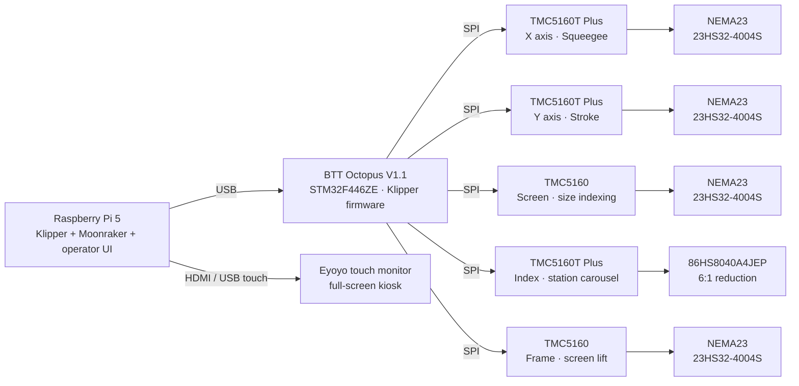

# LP1 — Automatic Screen Printing Machine

[Español](README.es.md) · **English**

Control system for a commercial automatic screen printing machine with a CoreXY print head, a 4-station carousel and five stepper axes. The whole machine is driven by a **Raspberry Pi 5 running Klipper**, connected over USB to a **BTT Octopus V1.1** (STM32) board, with a custom touchscreen interface for the operator.

The project replaced an earlier architecture based on Marlin firmware, a Teensy/ESP32 sequencer and a Wecon HMI with a single, fully software-defined control stack.

## Highlights

- **5-axis motion control** with Klipper: CoreXY head (stroke + squeegee), carousel indexer, screen size indexer and screen frame lift.
- **Sensorless homing** (TMC5160 StallGuard) on four axes, calibrated per axis and per homing speed.
- **Complete print cycle written as Klipper macros** (G-code + Jinja2): flood stroke, synchronized frame and squeegee motion, print stroke, carousel advance and part detection.
- **Custom operator interface**: single-page HTML/JavaScript app talking to Moonraker over WebSocket (JSON-RPC), bilingual Spanish/English, running as a full-screen kiosk.
- **Safety logic in software**: guarded manual mode, homing required before any cycle, emergency stop button with immediate firmware shutdown.
- **Automated macro validation**: a Python test harness that renders every macro with Jinja2 exactly as Klipper does, before deploying to the machine.

## Control architecture

## Hardware

### Control and interface

| Component | Model | Role |
|---|---|---|
| Control computer | Raspberry Pi 5 | Runs Klipper host, Moonraker API and the operator web interface |
| Controller board | BTT Octopus V1.1, STM32F446ZE | Runs the Klipper MCU firmware and drives all motor drivers over SPI |
| Display | Eyoyo touch monitor, HDMI + USB | Operator interface in full-screen kiosk mode |
| Power supply | 24 V DC, 12 A | Motor driver power rail |

### Axes, drivers and motors

| Axis | Function | Driver | Motor | Run current | Homing |
|---|---|---|---|---|---|
| **X** | Squeegee up/down | TMC5160T Plus, SPI | NEMA23 StepperOnline 23HS32-4004S, 2.4 Nm | 2.0 A | Sensorless, StallGuard |
| **Y** | Stroke, long carriage travel | TMC5160T Plus, SPI | NEMA23 StepperOnline 23HS32-4004S, 2.4 Nm | 2.0 A | Sensorless, StallGuard |
| **Screen** | Size indexing | TMC5160, SPI | NEMA23 StepperOnline 23HS32-4004S, 2.4 Nm | 2.0 A | Sensorless, StallGuard |
| **Index** | 4-station carousel | TMC5160T Plus, SPI, dedicated 24 V HVIN | 86HS8040A4JEP with 6:1 mechanical reduction | 2.8 A | NPN inductive sensor |
| **Frame** | Raises and lowers the screen frame | TMC5160, SPI | NEMA23 StepperOnline 23HS32-4004S, 2.4 Nm | 1.2 A | Sensorless, StallGuard |

All drivers run in SpreadCycle mode for maximum torque and reliable stall detection.

### Sensors and inputs

- **Part sensor:** NPN diffuse photoelectric sensor that detects the garment on the carousel, so empty stations are skipped automatically.
- **Carousel home:** NPN inductive sensor.
- **Emergency stop:** industrial mushroom button wired to the Octopus; pressing it shuts the firmware down immediately and the motors stop within tens of milliseconds.

## Axis mapping (CoreXY)

| Axis | Function | Direction |
|---|---|---|
| **Y** | Stroke | `Y+` towards one end, `Y-` towards the other |
| **X** | Squeegee | `X+` = up, safe position · `X-` = down, towards the mesh |

The head is mechanically CoreXY: both motors turning the same way produce the stroke, turning in opposite directions produce the squeegee movement.

## Print cycle

The operator homes the machine with `HOME_ALL` and starts production with `START`. Each print cycle is:

1. **Flood stroke:** the carriage travels to the far end with the squeegee and the frame raised, spreading ink over the screen with the floodbar. In carousel mode this runs while the carousel is rotating, to save cycle time.
2. **Lowering:** the frame and the squeegee go down together.
3. **Print stroke:** the carriage returns with the squeegee down, printing the garment.
4. **Raising:** the squeegee and the frame go up together, with the squeegee leaving the mesh first.
5. **Carousel advance:** the carousel indexes to the next station. The part sensor decides whether the next station is printed or skipped.

Two operating modes are available: **head mode**, a single print station, and **carousel mode**, a continuous 4-station loop. All cycle parameters — positions, speeds, start side and frame on/off — are adjusted from the touchscreen and persisted on the machine.

## Operator interface

A touchscreen web application in `ui/index.html`, launched at boot as a kiosk: cage + Chromium as a systemd service, with a custom Plymouth boot splash.

- **Main screen:** homing, start/stop and live cycle status.
- **Manual mode:** every step of the automatic cycle available as an individual button, so operators can also produce step by step. It uses exactly the same positions, speeds and accelerations as the automatic cycle, and guards against unsafe actions: no motion without homing, no motion while a cycle is running, and no squeegee descent unless the frame is in position.
- **Settings:** speed on a 0–99 scale, with 99 equal to 21,000 mm/min, plus head and carousel positions.
- **Menu:** access to settings, manual mode and language selection.
- **Emergency stop screen:** shown as soon as the physical button is pressed, with a reset button to restart the firmware.

## Engineering notes

Some of the problems solved during development:

- **StallGuard calibration depends on speed.** The stall threshold that homes reliably at one speed fails at another, so each sensorless axis was calibrated by bisection at its actual homing speed and acceleration, and the homing macros pin those values explicitly.
- **Asynchronous sensors inside Klipper.** Measurements showed that `gcode_button` events are queued until the running macro finishes. The carousel loop was redesigned as a two-step cycle — one step to move, one to read the part flag — so detections are never lost.
- **Motion profile limits.** On short moves the velocity profile is triangular and the commanded speed is never reached; peak speed is bounded by √(acceleration × distance). Acceleration was raised step by step and verified against homing repeatability to detect lost steps.
- **Configuration load order.** Virtual endstop pins from the TMC drivers must be registered before the stepper that uses them, which defines the section order in `printer.cfg`.
- **Safe state after motor release.** `M84`/`M18` are intercepted so that any motor release aborts the running cycle and invalidates all homes, forcing a new homing before production resumes.
- **One source of truth.** Manual and automatic modes read the same saved parameters, so a change in settings applies to both and they can never print differently.

## Repository structure

| Path | Contents |
|---|---|
| `pi-config/printer.cfg` | Main Klipper configuration: axes, TMC5160 drivers, part sensor, emergency stop, `G28` override. |
| `pi-config/macros_ciclo.cfg` | Print cycle, carousel loop, operating modes and operator parameters (`SET_CYCLE`). |
| `pi-config/macros_marco.cfg` | Frame motor: sensorless homing, lowering and raising. |
| `pi-config/macros_manual.cfg` | Manual mode macros. |
| `pi-config/macros_index.cfg` | 4-station carousel: homing, indexing and part sensor. |
| `pi-config/macros_screen.cfg` | Screen size indexing. |
| `pi-config/variables.cfg` | Persisted operator settings: calibrated positions, speeds and mode. |
| `pi-config/moonraker.conf`, `fluidd.cfg`, `system/` | Moonraker, Fluidd and kiosk services: nginx, cage and Chromium. |
| `pi-config/tests/validar_macros.py` | Macro validator that renders every macro with Jinja2 as Klipper does. |
| `ui/` | Operator touchscreen interface. |
| `boot/` | Custom boot splash and Raspberry Pi boot configuration. |
| `_legacy/` | Previous Teensy/ESP32 sequencer firmware, kept for reference. |

The live configuration runs on the Raspberry Pi in `~/printer_data/config/`; `pi-config/` is its version-controlled copy and is deployed to the machine after every change.

## Roadmap

- Hardware power cut on the emergency stop: wire the button's NC contact in series with the 24 V driver supply, so the stop no longer depends on the controller.
- Calibrate squeegee and frame travel in real millimetres.

## Tech stack

Klipper · Moonraker · Raspberry Pi OS · STM32 · TMC5160 · G-code / Jinja2 macros · HTML / CSS / JavaScript · WebSocket JSON-RPC · Python · systemd · nginx · Git
